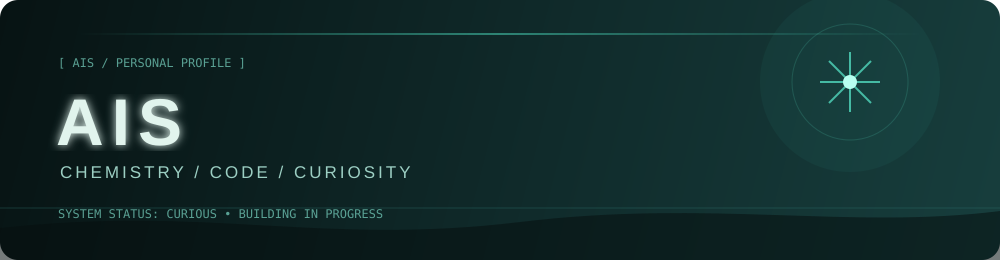

<p align="center">
  
</p>

<p align="center">
  
  
</p>

<p align="center">
  
</p>
<p align="center">
  <em>“A calm mind in a chaotic world.”</em>
</p>

<p align="center">
  
  
  
  
</p>

<p align="center">
  
</p>

## 01 / ABOUT

```yaml
Focus     : Python • Cybersecurity • Ethical Hacking
Languages : Python • Bash
Mode      : Analyze / Exploit / Secure
